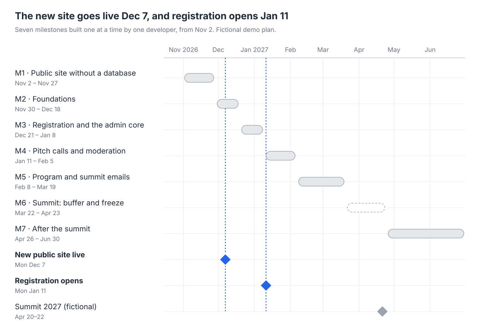

# VRC roadmap: from today's site to the V3 designs

As of Oct 30, 2026 · Vert Robo Con (VRC) is a fictional organisation; every name, figure and address in this plan is demo content.

## Summary

One developer builds everything, one stage at a time. Work that needs no database comes first, and work the 2027 summit doesn't need comes after it.

- **Mon Dec 7, 2026:** the new public site in the V3 look replaces today's pages.
- **Mon Jan 11, 2027:** the site moves to its own server, and 2027 registration opens on it.
- **Around Mon Jan 25:** the startup and research pitch calls open.
- **Fri Mar 19:** the 2027 program is published and the summit emails have been rehearsed.
- **Apr 20–22, 2027:** the summit.
- **Until Jun 30:** the recordings, then the features that can wait until after the summit.

The dates assume one developer working full time with no holiday break. Each week off moves every later date by a week. The work is tracked as GitHub issues, listed in [#74](https://github.com/lanterno/vert-robo-con/issues/74), and each stage below lists the issues it covers.

| Stage | Dates (2026–27) | Ends with |
| --- | --- | --- |
| 1 · Public site without a database | Nov 2 – Nov 27 | Every public page rebuilt in the V3 look; live on Dec 7 |
| 2 · Foundations | Nov 30 – Dec 18 | The app, database, sign-in, email and backups running on staging |
| 3 · Registration and the admin core | Dec 21 – Jan 8 | The site on its own server; registration opens Jan 11 |
| 4 · Pitch calls and moderation | Jan 11 – Feb 5 | Pitch calls open, one moderation queue for every submission |
| 5 · Program and summit emails | Feb 8 – Mar 19 | 2027 program published, full rehearsal passed |
| Summit | Mar 22 – Apr 23 | Buffer, change freeze from Apr 5, the summit |
| 6 · After the summit | Apr 26 – Jun 30 | Recordings, the deferred features, the old tools switched off |

**The registration date.** The site announces registration for Mon Dec 7 and the startup pitch call for Tue Dec 8 (#3). On this schedule registration is ready around Jan 8, so it opens Mon Jan 11. Decide at the end of stage 1, on Nov 27:

- **Keep this order:** move the opening to Jan 11.
- **Build registration before the redesign:** registration opens on Dec 7 in today's look, and the new design moves to January.

Edition and call dates are stored in the database (#39, #51), so moving them is an edit in the admin, not a code change.

**Where the site is today.**

- A small static Astro site with 9 pages, deployed to GitHub Pages on a preview domain.
- All content is hard-coded in TypeScript, mainly `src/lib/summits-data.ts`. TinaCMS is installed, but no page reads from it.
- The map reads a fictional dataset of 120 organisations from `src/data/organizations.json` at build time.
- There are no tests, no server code and none of the V3 colours or fonts.

**What the V3 designs add.**

- **Public site:** 15 boards in the V3 look. Every external form, spreadsheet, document and PDF is replaced by built-in pages and forms.
- **Backoffice:** 12 admin boards, built as screens in the same app.
- **Server:** the site moves to its own server.

## Architecture

Approved in #1:

- **One TypeScript app.** Astro in server mode serves the public site, My VRC (`/me`) and the admin (`/admin`). A worker process from the same code runs background jobs with pg-boss.
- **One database:** Postgres, with schema and migrations in Drizzle.
- **Sign-in with better-auth.** Admins sign in with a password plus required 2FA. Visitors only ever get email magic links.
- **Nothing extra to run.** No CMS, no separate newsletter tool and no sign-in proxy. Pages read the database directly, so an edit never needs a rebuild.
- **One server with Docker Compose:** Caddy, the app, the worker and Postgres, with restic backups and uptime monitoring from outside. The email provider, DNS and other server settings are configured when the server is set up, not in code (#18).

## Decisions

| Decision | Answer | Issue |
| --- | --- | --- |
| Architecture | Approved for now | #1 |
| Who builds it | One developer | #2 |
| Launch dates | Registration Dec 7 and pitches Dec 8 for now. The dates live in the database so they can move | #3 |
| First admin | A default `admin` account. Its password and 2FA must be set at the first sign-in, and that admin invites the others | #4, #13 |
| Privacy: legal entity, legal basis, retention periods | Open. No form may collect personal data in production until it is settled | #5 |
| Email provider and DNS | Configured at server setup | #18 |
| Copy | The copy on the current canvas ships as it is | #7 |
| Analytics | Cloudflare Web Analytics | #8 |
| Old form responses | Open, decided after the summit | #72 |

## Stage 1 · Public site without a database (Nov 2 – Nov 27)

Everything a visitor reads, built from the data files already in the repo. It keeps deploying to GitHub Pages, so pages can go live one at a time.

- [ ] The base: V3 tokens and self-hosted fonts (#24), shared components (#25), a data layer over the TypeScript files (#26), and TinaCMS removed (part of #10)
- [ ] The pages, each with its phone layout:
    - Home (#27), Summit (#28), past programs (#29), Watch (#30)
    - Research reader (#31), Map with its data downloads (#32), People (#33), News (#34)
    - Get Involved (#35), Jobs layout (#36), Contact and the Privacy draft (#37)
- [ ] Redirects, 404, sitemap and social cards (#38), and Cloudflare Web Analytics (#8)
- [ ] Smoke tests, accessibility checks and the link check against the static build (part of #12)

Forms that don't exist yet show their state, such as "Opens Jan 11" or "Coming soon", instead of linking to an outside tool.

**Done when:** every page has been checked on desktop and phone. **Mon Dec 7:** the new public site goes live.

## Stage 2 · Foundations (Nov 30 – Dec 18)

- [ ] Astro in server mode, with a health check and the worker entry point (#10)
- [ ] Postgres, migrations and the synthetic seed (#11), and tests against a seeded database (#12)
- [ ] Admin sign-in with required 2FA, including the default admin's forced password change (#13)
- [ ] Visitor magic links (#14), the mailer over SMTP with Mailpit in development (#15), background jobs (#16) and spam protection for forms (#17)
- [ ] The servers, the Compose stack, backups with a restore drill, monitoring, CI/CD and the runbook (#18–#23)

**Done when:** staging runs the app, an admin can't get in without 2FA, and a backup has been restored by following the runbook.

## Stage 3 · Registration and the admin core (Dec 21 – Jan 8)

Only editions, registrations and admins live in the database at this point. News, people, videos and the other content stay in the TypeScript files until after the summit, so the content admin can wait.

- [ ] Editions with their dates and registration window, edited in the admin (#39)
- [ ] Registration with its confirmation email, magic link and .ics file (#40), and the first version of My VRC (#41)
- [ ] The admin shell (#42), registrations (#43), admins and the audit log (#44), settings (#46), system status (#47) and the first dashboard (#48)
- [ ] The launch checklist (#49):
    - someone outside the project reviews the sign-in and magic-link code
    - the final privacy text is in place (#5)
    - email reaches Gmail and Outlook inboxes
    - DNS points at the server

**Mon Jan 11:** the site runs from its own server, and registration opens.

## Stage 4 · Pitch calls and moderation (Jan 11 – Feb 5)

What the summit needs from the community side:

- [ ] One moderation queue for every kind of submission (#50)
- [ ] The startup and research pitch calls (#51). They open about two weeks into the stage, around Mon Jan 25
- [ ] Pitch review and decisions (#52)
- [ ] Joining the network, with manual approval and the Slack invite only in the approval email (#53)
- [ ] The contact form and the consulting enquiry (#54)

**Done when:** a test pitch goes from the form through review to a decision email, and shows its status in My VRC.

## Stage 5 · Program and summit emails (Feb 8 – Mar 19)

- [ ] The program builder, which moves sessions and people into the database (#61)
- [ ] The 2027 program: saved agenda, calendar feed, join links for registrants and a Now/Next strip (#62)
- [ ] The reminder and join-link emails (#66)
- [ ] The full dashboard (#67)
- [ ] A full rehearsal and a load test of registration (#69)

**Done when:** the program is published and the rehearsal passes: register, get the reminder, get the join link, open My VRC, download your data, delete it.

## Summit (Mar 22 – Apr 23)

- Mar 22 – Apr 2: buffer, and late changes to the program
- From Apr 5 to Apr 23: only content changes and urgent fixes are deployed (#70)
- Apr 20–22: be on call each day for uptime alerts and email bounces, and check that the join-link email reached every registrant (#70)

## Stage 6 · After the summit (Apr 26 – Jun 30)

The recordings come first (#71). Then the features that nothing in the 2027 edition depends on, in this order:

1. The content admin, which moves news, people, videos and documents into the database (#45)
2. The map data in the database, and map suggestions with moderation (#55, #56)
3. The jobs board and internship applications (#57, #58)
4. The smaller forms (#59), then the end-to-end check of every submission type (#60)
5. My VRC complete (#63), data export and retention jobs (#64), and topic emails with the monthly digest (#65)
6. PDFs of the program, white paper and sponsor deck (#68)
7. Switching off the old tools (#72), then the retrospective and the maintenance routine (#73)

## Board by board

| Board | Static part | Server features |
| --- | --- | --- |
| HomeV3 | Stage 1 | Join sheet, stage 4 |
| SummitV3 | Stage 1 | "Register" button and edition state from the database, stage 3 |
| ProgramV3 | Stage 1 (past editions) | 2027 agenda, calendar feed, join links, stage 5 |
| RegisterV3 | — | Stage 3 |
| GetInvolvedV3 | Stage 1 | Pitch calls, stage 4; the smaller forms, stage 6 |
| MyVRCV3 | — | Registrations, stage 3; pitches and join requests, stage 4; the rest, stage 6 |
| PhoneV3 | Stage 1 | Follows each desktop board |
| MapV3 | Stage 1 (map and downloads) | Suggestions, stage 6 |
| ResearchV3 | Stage 1 (reader) | Section suggestions, stage 6 |
| WatchV3 | Stage 1 | New-video emails, stage 6 |
| JobsV3 | Stage 1 (layout) | Listings and applications, stage 6 |
| ContactV3 | Stage 1 (FAQ and email link) | Contact and consulting forms, stage 4 |
| NewsV3 | Stage 1 | Digest signup, stage 6 |
| PeopleV3 | Stage 1 | — |
| PrivacyV3 | Stage 1 (draft) | Final text before registration opens (#5) |
| AdminEditionV3, AdminRegistrationsV3, AdminUsersV3, AdminSettingsV3, AdminSystemV3 | — | Stage 3 |
| AdminDashboardV3 | — | First version stage 3, full version stage 5 |
| AdminQueueV3, AdminPitchesV3 | — | Stage 4 |
| AdminProgramV3 | — | Stage 5 |
| AdminContentV3, AdminMapV3 | — | Stage 6 |

StackV3 is a reference board for the earlier stack proposal; #1 replaces it.

## Risks

| Risk | What happens | What we do |
| --- | --- | --- |
| One developer | Illness, holidays or other work move every later date | Summit-critical work comes first and the rest waits until after the summit |
| Only one person knows the system | Nobody else can deploy, restore or fix it | Tests in CI, and a runbook written so someone else could follow it; the restore drill uses only the runbook (#20, #23) |
| Registration runs late | The announced Dec 7 date slips | Decide on Nov 27; moving the date is an edit in the admin |
| One server | An outage takes everything down | Backups every 4 hours, a restore drill, and a static fallback snapshot (#20) |
| Email lands in spam | Magic links and receipts don't arrive | SPF, DKIM and DMARC at server setup, and an inbox test before launch (#18, #49) |
| The default admin password is public | Anyone could sign in to a fresh deploy | Sign in and change it right after every fresh deploy (#13) |
| An admin loses their 2FA device | Locked out of the admin | Recovery codes, another admin can reset 2FA, and owner recovery from the server shell in the runbook |
| Privacy text not ready | Registration can't open | Start the legal review before stage 3 (#5) |
| The Slack invite link is passed around | Unapproved people join | The link appears only in approval emails and is rotated (#53) |

**Out of scope for this roadmap:**

- paid or in-person tickets, check-in and badges
- a public member directory
- file uploads for CVs and decks; links only
- importing old social media posts
- running the Field Skills Course and the Schools Programme themselves; only their toggles are in scope
- running our own geocoding server
