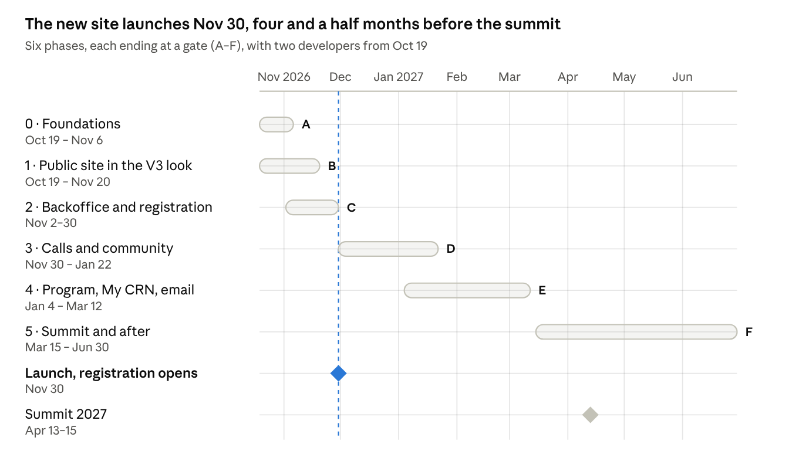

# CRN roadmap: from today's site to the V3 designs

As of Oct 18, 2026 · Live version with comments: [Claude doc](https://claude.ai/code/artifact/8b88a0ef-9b94-4a6b-a720-5054f6ad5366) · Mockups: [design canvas](https://claude.ai/artifact/EnFDCdkPwYzXUNNW8Ha5Va)

## Summary

With two developers starting Mon Oct 19, the new site can launch on climaterobotics.network on **Mon Nov 30, 2026**, with built-in registration open that day. The rest of the backoffice would be finished by mid-March, a month before the April 13–15, 2027 summit.

**Where the site is today.**

- The repo is a small static Astro site of about 7,700 lines and 9 pages, deployed to GitHub Pages at crn.elghareeb.space.
- All content is hard-coded in TypeScript, mainly `src/lib/summits-data.ts` (1,419 lines). TinaCMS is installed, but no page reads from it.
- The map is built from the public Google Sheet and fails silently to an empty map if the Sheet can't be read.
- There are no tests, no server code and none of the V3 colours or fonts.
- The official climaterobotics.network is still a separate GoDaddy-built site with 108 links out to Google Forms, Sheets, Docs, PDFs, Slack and YouTube.

**What the V3 designs add.**

- **Public site:** 15 boards in the V2 look, with every one of those 108 external links replaced by built-in pages and forms.
- **Backoffice:** 12 boards on Payload CMS, behind a tailnet and required 2FA.
- **Server:** the whole site moves to its own server, a Hetzner AX42 at about €110–115 a month.

**Phases at a glance:**

| Phase | Dates (2026–27) | Ends with |
| --- | --- | --- |
| 0 · Foundations | Oct 19 – Nov 6 | Gate A: server, backups and the 2FA-protected admin running on a staging hostname |
| 1 · Public site in the V3 look | Oct 19 – Nov 20 | Gate B: every public page rebuilt from today's data, on staging |
| 2 · Backoffice core and registration | Nov 2 – Nov 30 | Gate C, **launch:** DNS cutover and registration opens |
| 3 · Calls, community and moderation | Nov 30 – Jan 22 | Gate D: pitches, Slack joins, map suggestions, jobs and contact built in; the Google Forms and Sheets closed |
| 4 · Program, My CRN and email | Jan 4 – Mar 12 | Gate E: program published, full My CRN, newsletter |
| 5 · Summit and after | Mar 15 – Jun 2027 | Gate F: change freeze, the summit, recordings, the Payload 4 upgrade |

The backend estimate is 6–10 developer-weeks of custom code plus about one week for required 2FA. The redesign of the public pages comes on top of that. That is why the plan needs two developers to keep the November and Dec 1 dates.

## Decisions needed before work starts

The first three block Phase 0 and should be settled in the first week. The rest can wait until the phase that needs them.

| Decision | Blocks | Proposed answer |
| --- | --- | --- |
| Approve the stack: Payload CMS on Postgres, listmonk plus Amazon SES, and Caddy with Docker Compose on a Hetzner AX42 | Phase 0 | Approve as researched |
| Choose how required 2FA is enforced: authentik in front of every admin tool, or the payload-better-auth plugin (MIT) inside Payload | Phase 0 | authentik: one 2FA sign-in also covers listmonk, Umami and Beszel; the plugin is still pre-1.0 |
| Who builds it, and how many developers | All dates in this plan | Two developers from Oct 19, one frontend and one backend. With one, the timeline roughly doubles and November is missed |
| Name the owner (first admin) and the first 2–3 admins | Phase 0 | Open: who owns the backoffice? |
| Access to the climaterobotics.network DNS and an AWS account for SES | Phase 0 email, Phase 2 cutover | Set up now; email domain checks take days |
| When 2027 registration opens | Order of Phases 3–4 | Keep the live site's promises: registration opens Mon Nov 30, startup pitches Dec 1. Fallback: both open Jan 11 |
| Legal entity, legal basis and retention periods for the Privacy page | Launch and registration (Phase 2) | Needs legal review |
| What to do with old Google Form responses | Phase 5 | Export to encrypted storage with a set deletion date; no bulk import |
| Confirm drafted copy: sponsor tiers, FAQ, internship descriptions, news authors | Phase 1 content | Owner reviews the drafts on the canvas |
| Import old LinkedIn posts into News | Phase 2 content | Not needed for launch |
| Find the 15 missing 2025 recordings (33 sessions, 18 videos in the repo) | Phase 1 Watch page | Ask the 2025 organisers; otherwise show "18 of 33" |

## Phase 0 · Foundations (Oct 19 – Nov 6, backend developer)

By Nov 6 the server runs the full stack on a staging hostname. Admin tools are reachable only over the tailnet and only with 2FA, and one backup has been restored.

**Week 1, things that take days to come back:**

- [ ] Order the Hetzner AX42 (Ubuntu 24.04, FSN1 or HEL1) and sign Hetzner's data processing agreement
- [ ] Request Amazon SES production access in eu-central-1, since AWS can take up to 96 hours to reply, and sign the AWS data processing agreement
- [ ] Add SPF, DKIM and DMARC for climaterobotics.network. They must cover both SES and whoever hosts the patrick@ mailbox
- [ ] Decide Tailscale or self-hosted Headscale for the tailnet. Tailscale is free only if CRN qualifies as non-commercial

**Weeks 1–2, the server:**

- [ ] Harden the server: SSH keys only, firewall, automatic security updates, tailnet
- [ ] Create a `crn-infra` Git repo holding Docker Compose files for:
    - Caddy
    - Postgres 17, with one database each for Payload, listmonk and Umami
    - Payload 3.91.x
    - listmonk
    - Umami
    - Beszel
    - authentik
- [ ] Set up Renovate for dependency updates and a monthly patch day
- [ ] Put the admin, newsletter and stats hosts on the tailnet only. The public hostname exposes only `/api/public/*`
- [ ] Set up authentik with required passkey or authenticator-app sign-in plus recovery codes, in front of the admin host including `/api` and in front of listmonk, Umami and Beszel. A new admin sets up 2FA before seeing anything

**Weeks 2–3, safety and delivery:**

- [ ] Back up the databases every 4 hours, and back up uploads and config nightly with restic to a Hetzner Storage Box in the other region, with a second copy elsewhere
- [ ] Run the first restore drill and write down how long it took
- [ ] Put Uptime Kuma on a small server at another provider, with heartbeats from backups and builds
- [ ] Make Caddy serve the Astro build as atomic releases, keeping the last 5 so a rollback is a symlink swap, plus the redirect map from old URLs
- [ ] Add CI that builds the site on each push to main and deploys it to staging over the tailnet
- [ ] Write the first RUNBOOK covering deploy, rollback, restore and rotating secrets

**Gate A (Nov 6):** today's site is served from the new server on staging, an admin cannot sign in without 2FA, and a restore has been done from backup.

## Phase 1 · Public site in the V3 look (Oct 19 – Nov 20, frontend developer)

By Nov 20 every public page is rebuilt in the V3 look on staging, using today's data and no backend. Forms that aren't built yet keep linking to the old Google tool until Phase 3 replaces them.

**Week 1, the base everything else uses:**

- [ ] Replace the current colours and fonts (Oswald, Source Sans 3, #1e40af) with the V3 tokens: #0138AC blue, #1DB46C green, Bricolage Grotesque, Geist and Geist Mono. Host the fonts on our own server so pages make no Google requests
- [ ] Build the shared components:
    - header with the Community and About menus and the footer, exactly as on the boards
    - buttons and status chips. Blue is only for things you can act on; "Coming soon" and the like stay grey
    - bento tiles, the person drawer, and a form sheet shell with Esc to close and focus kept inside it
- [ ] Add a small data layer (`getEditions()`, `getPeople()`, `getVideos()` and so on) that reads today's TypeScript files. In Phase 2 it switches to Payload without touching the pages
- [ ] Remove TinaCMS: nothing reads from it, and Payload replaces it
- [ ] Copy the map Sheet into a JSON file in the repo now, with country spellings merged into 29 countries. This stops the map going empty when the Sheet can't be read

**Weeks 2–5, the pages:**

| Board | Routes | Notes |
| --- | --- | --- |
| HomeV3 | `/` | Map stats come from the dataset |
| SummitV3 | `/summits`, `/summits/2024`–`/summits/2027` | The state (upcoming, open, closing soon, live, concluded) is worked out in the browser from the edition's dates |
| ProgramV3 | `/summits/[year]/program`, session pages | Filters, local time, .ics files. The 2024 Google Doc and 2025 PDF become archive editions |
| WatchV3 | `/watch`, video pages | 18 of the 33 2025 sessions; a light youtube-nocookie player |
| ResearchV3 | `/research`, `/research/white-paper/2025`, `/principles`, `/deployment-code`, `/code-of-conduct` | A reader that replaces the white paper PDF and Google Docs |
| MapV3 | `/map` | Rewritten on MapLibre with self-hosted PMTiles (no more unpkg, CARTO or Esri). CSV, JSON and GeoJSON downloads under CC BY 4.0, with a "How to cite" block |
| PeopleV3 | `/people`, `/people/[slug]` | Team, advisors, speakers and white-paper authors |
| NewsV3 | `/news`, `/news/[slug]`, RSS | The 13 old blog posts |
| GetInvolvedV3 | `/get-involved` | Static parts: who it's for, sponsor tiers, FAQ, projects |
| JobsV3 | `/jobs` | Page layout and internship tracks; listings arrive in Phase 3 |
| ContactV3 | `/contact` | FAQ, topic routing, mailto patrick@ with "replies within 24–48 hours" |
| PrivacyV3 | `/privacy` | The draft, to be filled in after legal review |
| PhoneV3 | all of the above | Phone layouts with the tab bar and bottom sheets |

**Throughout:**

- [ ] Redirect every old GoDaddy URL (`/summits-2025`, `/team`, `/values`, `/projects`, `/internships`, `/f/*` and so on) to its new page
- [ ] Add smoke tests for every page, an accessibility check, and a link check that fails on any new link to Google Forms, Sheets or Drive

**Content the team must supply by Nov 6:** the white paper's source text, the 2024 agenda, the 13 old posts, confirmed sponsor tiers and FAQ, and any missing photos.

**Gate B (Nov 20):** the owner signs off every page on staging on desktop and phone.

## Phase 2 · Backoffice core and registration (Nov 2 – Nov 30, both developers)

On Nov 30 climaterobotics.network moves to the new server, and 2027 registration opens on it. From then on the content comes from Payload, and admins edit it there instead of in code.

**Content in Payload (backend, Nov 2–20):**

- [ ] Create the collections:
    - editions, sessions, people, partners, videos, news and documents
    - Site settings, holding the toggles for Online Academy, STEM, internship tracks and whether the research team is open
    - admins, audit events and site builds
- [ ] Write repeatable seed scripts that load `summits-data.ts` and `constants.ts` into Payload. Map organisations stay in the repo JSON until Phase 3
- [ ] Switch the Phase 1 data layer from the TypeScript files to Payload
- [ ] Rebuild the site automatically: one rebuild 60 seconds after the last publish, so a burst of edits costs one build, published as a release you can roll back. Also rebuild on schedule when registration opens and when it closes
- [ ] Restyle the Payload admin in the CRN look

**Registration (backend Nov 9–27, frontend Nov 16–27):**

- [ ] Create the 2027 edition record (April 13–15, online, free, open to everyone, registration opening Nov 30)
- [ ] Build the registration endpoint:
    - checks shared by the form and the server
    - ALTCHA, a hidden honeypot field and rate limits
    - the server rejects sign-ups outside the registration window
    - a repeat sign-up re-sends the link instead of creating a duplicate
    - references like CRN-2027-0142
    - records which version of the consent text was agreed to, and when
- [ ] Add magic links and the first version of My CRN at `/me`: see, cancel or add to calendar a registration, and download or delete your data
- [ ] Send the confirmation email through SES with the magic link and an .ics file
- [ ] In listmonk, add the "notify me" topics with double opt-in, and a private 2027 registrants list kept in sync by Payload
- [ ] Build RegisterV3 and the registration part of MyCRNV3 (frontend)

**Admin screens in this phase:**

- AdminEditionV3: dates, registration window, state
- AdminRegistrationsV3: list, search, CSV export, re-send link
- AdminContentV3
- AdminSettingsV3
- AdminUsersV3: invite or remove admins, 2FA status, reset 2FA, audit log
- AdminSystemV3: builds and rollback, email templates, backup status
- A first AdminDashboardV3 with today's registrations and recent builds

**Launch week (Nov 23–30):**

- [ ] An outside reviewer checks the magic-link and sign-in code
- [ ] Finish the Privacy page with the legal entity, legal basis and retention periods
- [ ] Two people each do one deploy and one restore on their own
- [ ] Test that email lands in inboxes, not spam, on Gmail and Outlook
- [ ] Switch the 4 references from crn.elghareeb.space to climaterobotics.network (`public/CNAME`, `astro.config.mjs`, `src/lib/constants.ts`, `README.md`)
- [ ] Lower the DNS TTL on Nov 23, then move climaterobotics.network from GoDaddy to the server on Nov 30. Keep the GoDaddy site and GitHub Pages as a fallback for 30 days
- [ ] Close the 2027 registration Google Form with a note pointing to the new page

**Gate C (Nov 30) · Launch:** the new site is live on climaterobotics.network, and a test registration gets its email and opens My CRN.

## Phase 3 · Calls, community and moderation (Nov 30 – Jan 22)

By Jan 22 no page links to a Google Form, Sheet, Doc or Drive file. Every submission lands in one moderation queue, and its sender can follow it in My CRN. Each Google Form closes the day its replacement goes live. Its old responses are left as they are, as decided.

Items are listed in the order their deadlines force:

| When | What | Replaces | Boards |
| --- | --- | --- | --- |
| Dec 1 | Startup and research pitch calls. On Dec 1 a one-step form writes to the pitches collection; the 4-step form with "Save and finish later" follows by Dec 18. References like PIT-2027-018 | 2026 startup and research pitch Forms | GetInvolvedV3, MyCRNV3 |
| Dec 1–18 | Pitch review: any admin scores, with their name shown. Decisions are held as pending and sent out together | Reviewing in Sheets | AdminPitchesV3 |
| Dec 1–18 | One moderation queue with counts for each type. It covers join requests, map suggestions, job posts, internship applications, messages, document suggestions, research topics and reports of concern | Nothing; these were ad hoc | AdminQueueV3, AdminDashboardV3 |
| Dec 7–18 | Joining the network. The Slack invite link appears only in the approval email. A daily check warns before the link expires (after 30 days or 400 uses). The email-only digest is still instant | Public Slack invite links | HomeV3 join sheet, MyCRNV3 |
| Dec 7–18 | Contact form routed by topic, and the 2-step consulting enquiry. It emails patrick@ with Reply-To set to the sender. References like MSG-1093 | GoDaddy contact form, "DM us" | ContactV3 |
| Dec 14 – Jan 15 | Map moderation, below | Map Google Sheet | MapV3, AdminMapV3 |
| Jan 4–22 | Jobs board: posts are reviewed, expire daily, and can be renewed, edited or closed through the magic link. References like JOB-0219. Internship applications for each track, with track toggles | Jobs Sheet, job and internship Forms | JobsV3, MyCRNV3, AdminQueueV3, AdminSettingsV3 |
| Jan 4–22 | The smaller forms: sponsor interest, recommend a speaker, volunteer, register interest in STEM or the Academy, propose a research topic, join the research team, a private report-a-concern form, and "Suggest" on each section of the white paper | Slack messages, white-paper feedback Form | GetInvolvedV3, ResearchV3 |

**Map moderation in detail:**

- [ ] Import the 256 Sheet rows into an organisations collection, together with the existing geocoding cache and hand-made coordinate fixes
- [ ] Build "Suggest an organisation" and "Suggest an edit" with references like MAP-0457, and contributor terms on both forms
- [ ] Geocode each organisation once, when it is approved:
    - use Photon and Nominatim, at most one request a second
    - add an off switch in Site settings
    - approving triggers a rebuild that also regenerates the downloads
- [ ] Make the Sheet read-only for 2 weeks, then remove it and retire `scripts/geocode-orgs.ts`

**Gate D (Jan 22):** the link check finds no Google Forms, Sheets, Docs or Drive files, and a test submission of each type reaches the queue, the sender's email and My CRN.

## Phase 4 · Program, My CRN and email (Jan 4 – Mar 12)

By Mar 12 the 2027 program is published and every registrant can build an agenda. My CRN covers everything a visitor ever sent, and the reminder and join-link emails have been tested end to end.

**Program (backend and frontend, Jan 4 – Feb 12):**

- [ ] Build the program builder: sessions, speakers and tracks as drafts, a "provisional" marker, and publish. It is AdminProgramV3
- [ ] Turn accepted pitches into sessions and people
- [ ] On ProgramV3, add:
    - an agenda saved to the registration
    - a personal calendar feed
    - join links shown only to registrants
    - a "Now / Next" strip during the summit
- [ ] Generate PDFs in CI from the same data: the program, the white paper and the sponsor deck
- [ ] Settle the number of people pages: the board computes 46, the spec said 27

**My CRN and personal data (Jan 18 – Mar 5):**

- [ ] Complete MyCRNV3:
    - pitch, internship and job-post status, with edit, withdraw, renew and close
    - map suggestions and join-request status
    - email preferences and unsubscribe
- [ ] Make "Download my data" and "Delete everything" cover both Payload and listmonk, and log every deletion
- [ ] Add jobs that delete personal data after its retention period. The proposed 24 / 24 / 12 / 12 months still need approval

**Email (Feb 1 – Mar 12):**

- [ ] In listmonk, add the monthly digest, job alerts with saved filters, and "Email me new videos"
- [ ] Send registrants a reminder, then the join link a few days before the summit
- [ ] Finish AdminDashboardV3's "Today" view: the queue, registrations, warnings about the Slack link and backups, and recent builds

**Gate E (Mar 12):** a full rehearsal passes: register, get the reminder, get the join link, open My CRN, download the data, delete it. The registration endpoint also passes a load test.

## Phase 5 · Summit and after (Mar 15 – Jun 2027)

The site carries the summit without changes to its foundations, then the 2027 recordings go up and the old tools are switched off for good.

**Freezes:**

- From Nov 30 to Apr 16, the server only gets security patches: no version upgrades of Payload, Postgres or the other services.
- From Apr 6 to Apr 16, only content changes and urgent fixes are deployed.

**Summit week (Apr 13–15):**

- [ ] The edition switches to "live" by a scheduled rebuild, and back to "concluded" afterwards
- [ ] One developer is on call each day, watching uptime alerts and email bounces
- [ ] Check that the join-link email went to every registrant

**After the summit (Apr 16 – Jun):**

- [ ] The Watch page shows "Recordings in editing" until each 2027 video is published; speakers get their "Appears in" links
- [ ] Upgrade to Payload 4 around May, once 4.0 has had two patch releases, using the official codemod
- [ ] Do the quarterly restore drill, and keep the monthly patch day on the first Monday
- [ ] Hold a retrospective that checks the written triggers for adding tools. Add pretalx above about 150 pitches per call, more than 5 reviewers, or a need for a drag-and-drop schedule. Add pretix if paid or in-person tickets arrive. Add FreeScout above 100 messages a month

**Switching off the old tools:**

| Tool | When | Condition |
| --- | --- | --- |
| GoDaddy site and GitHub Pages deploy | Dec 30, 2026 | 30 days after launch with no rollback |
| Each Google Form | The day its replacement goes live | Old responses are kept until you decide what to do with them |
| Map Google Sheet | About Feb 1, 2027 | Read-only for 2 weeks after the import |
| Jobs Sheet and Drive PDFs | Jan 22, 2027 | Gate D passed |
| Google Form responses | Your call | The proposal: export to encrypted storage with a set deletion date; add to the newsletter only people who opted in |

**Gate F (Jun 2027):** recordings are published, the upgrade is done and the retrospective is written.

## Board-by-board map

All 27 canvas boards are covered: the static part of every public board ships by launch, and its server features follow the phase listed.

| Board | Static part | Server features | Depends on |
| --- | --- | --- | --- |
| HomeV3 | Phase 1 | Join sheet, Phase 3 | AdminQueueV3, AdminMapV3 stats |
| SummitV3 | Phase 1 | Edition state and "Register" pill, Phase 2 | AdminEditionV3 |
| ProgramV3 | Phase 1 (archives) | Saved agenda, calendar feed, join links, Phase 4 | AdminProgramV3 |
| RegisterV3 | — | All of it, Phase 2 | AdminEditionV3, AdminRegistrationsV3 |
| GetInvolvedV3 | Phase 1 | Pitch calls and smaller forms, Phase 3 | AdminPitchesV3, AdminSettingsV3 toggles |
| MyCRNV3 | — | Registrations Phase 2; everything else Phase 4 | Magic links |
| PhoneV3 | Phase 1 | Follows each desktop board | — |
| MapV3 | Phase 1 (MapLibre, downloads) | Suggestions and moderation, Phase 3 | AdminMapV3 |
| ResearchV3 | Phase 1 (reader) | Section suggestions, topics, concerns, Phase 3 | AdminQueueV3, AdminContentV3 |
| WatchV3 | Phase 1 | "Email me new videos", Phase 4 | AdminContentV3 |
| JobsV3 | Phase 1 (layout) | Listings and applications, Phase 3 | AdminQueueV3, AdminSettingsV3 |
| ContactV3 | Phase 1 (mailto, FAQ) | Contact and consulting forms, Phase 3 | AdminQueueV3 |
| NewsV3 | Phase 1 | Digest signup, Phase 4 | AdminContentV3 |
| PeopleV3 | Phase 1 | — | AdminProgramV3 |
| PrivacyV3 | Phase 1 draft; final text by launch | — | Legal review |
| StackV3 | — | The server itself, Phase 0 | — |
| AdminUsersV3 | — | Phase 0 (2FA), Phase 2 (screen) | authentik |
| AdminSystemV3 | — | Phase 2 | Phase 0 builds and backups |
| AdminEditionV3 | — | Phase 2 | — |
| AdminRegistrationsV3 | — | Phase 2 | RegisterV3 |
| AdminContentV3 | — | Phase 2 | Seed scripts |
| AdminSettingsV3 | — | Phase 2 | — |
| AdminDashboardV3 | — | First version Phase 2, full Phase 4 | Every other admin screen |
| AdminPitchesV3 | — | Phase 3 | GetInvolvedV3 calls |
| AdminQueueV3 | — | Phase 3 | Every public form |
| AdminMapV3 | — | Phase 3 | Sheet import |
| AdminProgramV3 | — | Phase 4 | Accepted pitches |

## Risks and scope

The biggest risk is the date: six weeks from today to a launch that also opens registration. Gate A on Nov 6 is the point to decide whether to keep Nov 30 or move both openings to Jan 11.

| Risk | What happens | What we do |
| --- | --- | --- |
| Launch work runs late | Registration and pitches miss their published dates | Decide at Gate A. Fallback: launch the site on Nov 30, open both on Jan 11, and update the page text |
| Only one developer | Every date roughly doubles | Hire or contract the second developer in week 1 |
| A lot of code that only CRN owns (6–10 developer-weeks) | Hard to maintain if the developer leaves | Tests in CI, a runbook, and two people who have each deployed and restored |
| A single physical server | An outage takes everything down | Database backups every 4 hours, restore within about 4 hours, and the static site can fall back to GitHub Pages |
| Email lands in spam, or SES approval is slow | Receipts and magic links don't arrive | Request SES in week 1, set up SPF, DKIM and DMARC, test inbox placement. Fallback: Lettermint or Postmark |
| An admin loses their 2FA device | Locked out of the backoffice | Recovery codes, any admin can reset another's 2FA, and an emergency procedure in the runbook |
| Privacy text not ready | No form may collect data | Launch is blocked on it; start the legal review now |
| The Slack invite link works for anyone who has it | Unapproved people join | The link appears only in approval emails and is rotated monthly |
| Breaking changes in Payload 4 | Upgrade work during the summit run-up | Stay on 3.91.x until May 2027 |
| listmonk has one main maintainer | No fixes if it is abandoned | Keila is the named fallback |
| Nominatim usage limits | Geocoding is blocked | Geocode only on approval, one request a second, with an off switch |

**Out of scope for this roadmap:**

- paid or in-person tickets, check-in and badges (pretix's trigger)
- a public member directory (still an open question)
- file uploads for CVs and decks; links only unless you decide otherwise
- importing old LinkedIn posts
- running the Online Academy and STEM programs themselves; only their toggles are in scope
- running our own geocoding server
